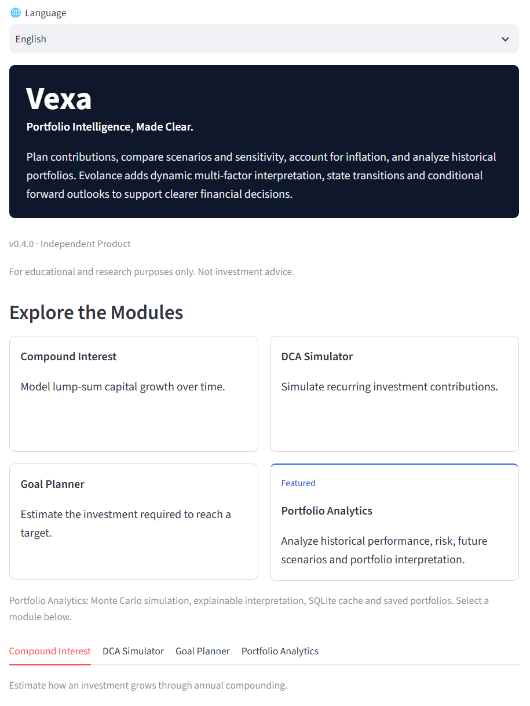
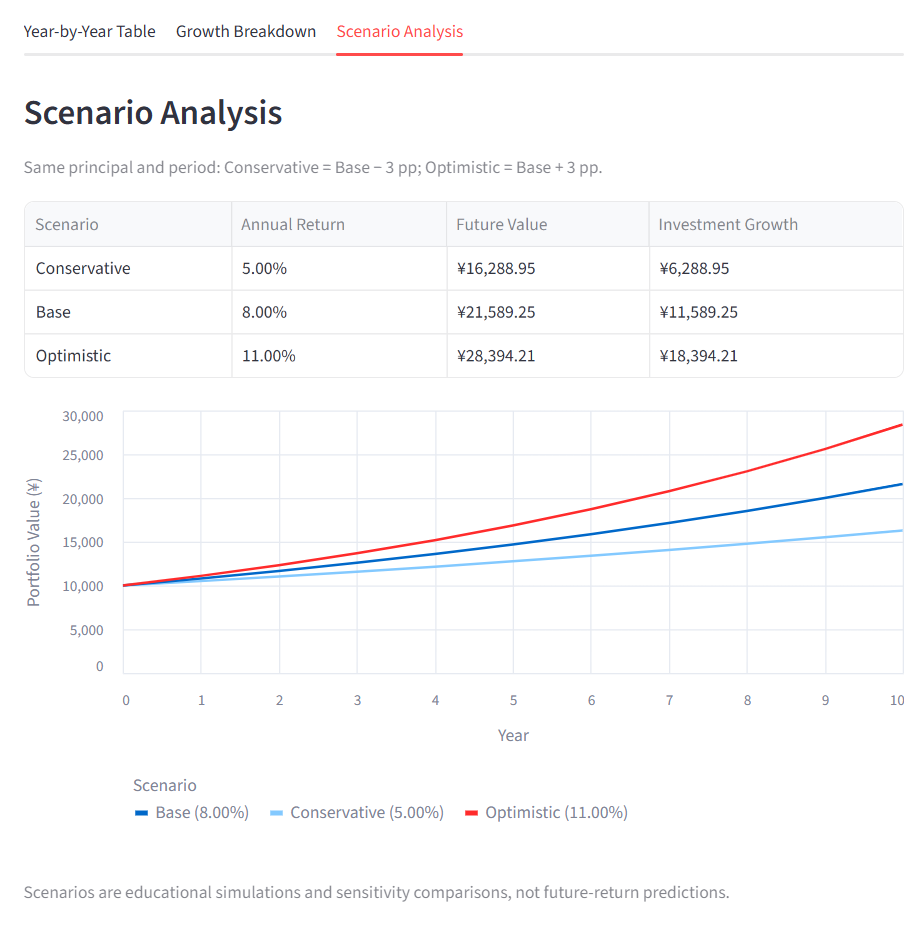
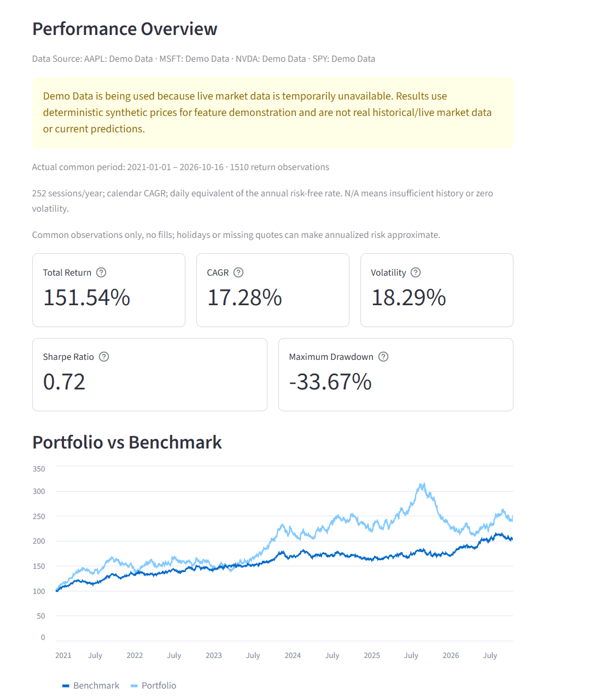
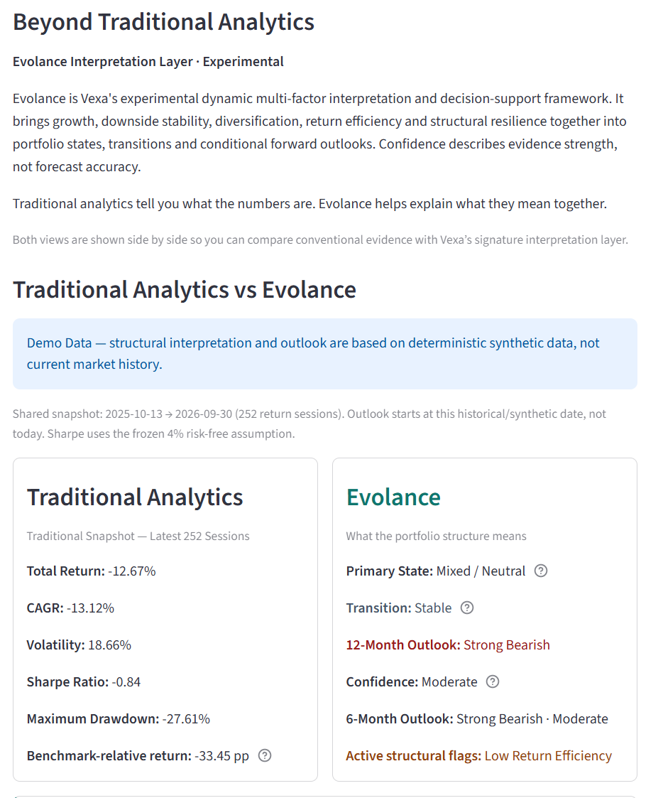

# Vexa

**Intelligent Financial Analysis & Decision Support Platform**

Plan contributions, compare scenarios, examine historical portfolios, and interpret their risk and return signals together with **Evolance**.

Vexa 将金融规划、情景分析、历史组合分析与 Evolance 动态多因素解释框架结合，辅助理解组合状态、变化趋势及条件性未来展望。

**[Open Live Demo](https://finance-mini-lab-knox.streamlit.app/) | [View GitHub](https://github.com/knoxlab01/Finance-Mini-Lab) | [Methodology](docs/METHODOLOGY.md)**

**v0.4.0 · Independent Product**

## Overview

Vexa is an independently designed and developed personal project connecting finance, data engineering and explainable decision support. It combines financial planning, historical market-data analysis, probabilistic simulation and an experimental interpretation framework in a bilingual English/Chinese Streamlit application.

“Intelligent” refers to transparent multi-factor rules and evidence-based interpretation, not guaranteed predictions.



The product overview connects planning tools and portfolio analysis through one bilingual interface.

## Why Vexa

Return, volatility, drawdown and simulated outcomes answer different questions. Seeing these numbers separately can make it difficult to understand how growth, downside risk and diversification interact. Vexa retains conventional analytics and places Evolance's structural interpretation beside them, with assumptions and limitations available for inspection.

## Core Capabilities

| Capability | Implemented behavior |
| --- | --- |
| **Financial Planning** | Annual compound interest, monthly DCA and goal-based required contributions; tables and growth charts. |
| **Scenario Analysis** | Conservative/Base/Optimistic comparisons for compound growth and portfolio forward scenarios. |
| **Sensitivity Analysis** | Goal Planner compares required monthly contributions across return and horizon assumptions. |
| **Inflation-adjusted Analysis** | Nominal future value, real purchasing power and purchasing-power loss under a fixed inflation assumption. |
| **Historical Analytics** | Multi-asset weights, five return/risk metrics, benchmark comparison, growth, drawdown and correlation. |
| **Future Outlook** | 1/3/5-year GBM Monte Carlo, P10/P50/P90, ending-value distributions and simulated loss probability. |
| **Evolance Framework - Experimental** | Five interacting dimensions, structural states/flags, transitions, conditional 6/12-month direction and ordinal confidence. |
| **Portfolio Guidance** | Explainable educational rules using risk preference, horizon, goal and available historical/simulated evidence. |

SQLite supports actual historical-price caching, saved portfolio configurations and analysis-source records. Saved names/configurations are shared within an app instance, not private accounts; avoid entering personal or sensitive information.

## Scenario Analysis

Compare Conservative, Base and Optimistic assumptions under the same principal and investment period. The compound-interest view shows how a three-percentage-point return change affects the growth curve and terminal value; it is a sensitivity comparison, not a forecast.



This example uses a principal of 10,000, a ten-year horizon and annual return assumptions of 5%, 8% and 11%.

## Historical Analytics

Enter unique stock/ETF tickers, nonnegative weights totaling 100%, a date range, benchmark and annual risk-free rate. Portfolio and benchmark growth start at 100 for direct comparison.

| Metric | Convention |
| --- | --- |
| Cumulative Return | Compounded daily portfolio returns. |
| CAGR | Elapsed calendar time, using 365.25 days/year. |
| Annualized Volatility | Sample standard deviation of daily returns multiplied by the square root of 252. |
| Sharpe Ratio | Daily risk-free-adjusted returns, annualized using 252 sessions. |
| Maximum Drawdown | Worst decline from prior wealth peak, including initial capital. |

Prices use common observed dates without forward/back filling. Portfolio returns assume daily target-weight rebalancing and exclude fees, taxes and slippage; this is not a buy-and-hold execution record.

**Data flow: SQLite Cache -> Yahoo Finance/yfinance -> deterministic synthetic Demo Data.** Yahoo uses adjusted historical Close. If fallback is needed, all assets and the benchmark switch together to labeled Demo Data, avoiding real/synthetic mixing. Demo supports **AAPL, MSFT, NVDA and SPY**; it is neither real history nor a market prediction, and is not stored as real-price cache data. No API key is required. Other tickers depend on live-provider availability.



The screenshot demonstrates five KPIs and benchmark growth using **deterministic synthetic Demo Data**. Its displayed returns are illustrative outputs, not real investment performance.

## Evolance Framework

**Experimental — A dynamic multi-factor interpretation and decision-support framework.**

Evolance organizes established financial evidence into **Growth Strength, Downside Stability, Diversification Quality, Return Efficiency and Structural Resilience**. Fixed scoring rules compare their balance and interaction over time. Monthly observations support state identification, persistent state confirmation and Stable/Deteriorating/Recovering transitions.

The product displays Traditional Analytics vs Evolance and an Evolance Takeaway. Where sufficient evidence exists, it shows **Strong Bullish**, **Bullish**, **Neutral / Uncertain**, **Bearish** or **Strong Bearish** for 6 and 12 months, accompanied by **High / Moderate / Low** confidence.

- Direction comes from a GBM distribution; states affect interpretation/confidence, **not** simulation drift or volatility.
- **Confidence reflects evidence strength, not forecast accuracy.** It is an ordered label, not a calibrated success probability. Synthetic Demo Data caps it at Moderate.
- A qualifying month-end needs 253 valid aligned prices; structural-change evidence needs four eligible monthly snapshots. Insufficient evidence is disclosed rather than fabricated.
- Evolance v1.1 is a **frozen experimental framework**, not a validated trading signal. A limited 2005-2017 AAPL/MSFT/NVDA/SPY walk-forward study retained failure cases and **did not establish predictive superiority**. Portfolio selection, overlapping horizons and lack of an untouched empirical holdout limit inference.

[Definitions and assumptions](docs/METHODOLOGY.md) | [Historical research report](docs/evolance_v1_1_real_validation.md) | [Frozen specification](docs/evolance_v1_1_frozen_spec.md)



The shared snapshot places conventional metrics beside state, structural flags, transition and conditional 6/12-month outlooks. This **Demo Data** example illustrates the framework's presentation; it is not evidence of forecasting accuracy or predictive superiority.

## Technology / Engineering

| Technology | Actual role |
| --- | --- |
| Python | Modular financial, data, simulation and interpretation logic. |
| Streamlit | Bilingual application, interactive controls and charts. |
| Pandas | Time-series cleaning, alignment and analytical tables. |
| NumPy | Numerical analysis and deterministic simulation. |
| SQLite / SQL (`sqlite3`) | Parameterized cache queries, portfolio persistence and analysis metadata. |
| yfinance | Primary retrieval of adjusted historical market prices. |

Dependencies: [runtime](requirements.txt), [development/tests](requirements-dev.txt).

## Product Architecture / Workflow

```text
Streamlit inputs + global language
    |-- Planning -> Compound Interest / DCA / Goal Planner
    |               + scenarios / inflation / sensitivity
    |-- Market Data <-> SQLite cache / portfolios / analysis provenance
         -> Historical Analytics
         -> Future Outlook (scenarios + GBM Monte Carlo)
         -> Evolance (frozen-rule interpretation)
         -> Educational Portfolio Guidance

Separate research: frozen specification -> walk-forward validation -> failure audits
```

Calculations, data access and presentation are modular. Private research inputs are separate from public runtime; raw private price histories and manifests are not distributed with the repository.

## Testing

**336 tests passed, 213 subtests passed, 0 failed** in the complete offline showcase check on 2026-10-16. No pytest warnings, skipped tests or xfails were reported.

Coverage includes financial formulas and edge cases, SQL create/read/write/update, mocked provider failures, deterministic Demo Data, Monte Carlo, frozen research integrity, no-look-ahead/month-end handling, bilingual UI and preserved inputs/results on language changes. Legacy research tests remain intentional preservation checks.

```powershell
python -m pip install -r requirements-dev.txt
python -m pytest -q -ra
```

The suite does not require successful live market-data requests. Historical real-data research reproduction separately requires authorized private source files; it is not part of the offline test requirement.

## Live Demo

**[Launch Vexa](https://finance-mini-lab-knox.streamlit.app/)** | **[Browse source](https://github.com/knoxlab01/Finance-Mini-Lab)**

For a quick walkthrough, select **Portfolio Analytics** and use `AAPL, MSFT, NVDA`, weights `40, 30, 30`, benchmark `SPY`, dates `2021-01-01` to `2026-01-01`, risk-free rate `4`. Click **Analyze Portfolio**, inspect Data Source and scroll to Evolance. Run Future Outlook and Portfolio Guidance to explore their controls. If live retrieval fails, labeled synthetic fallback supports this sample universe.

A human acceptance check in Chrome Incognito, signed out of both Streamlit and GitHub, confirmed anonymous access after clicking **Yes, get this app back up!** on the sleeping app. The owner confirmed working feature pages, language switching and the public repository link. The showcase refresh has been approved for publication; live deployment verification remains separate from that acceptance check. See the [deployment and audit checklist](docs/PUBLIC_SHOWCASE_AUDIT.md#deployment-and-anonymous-access).

### Run locally

```powershell
git clone https://github.com/knoxlab01/Finance-Mini-Lab.git
cd Finance-Mini-Lab
python -m venv .venv
.\.venv\Scripts\python.exe -m pip install -r requirements.txt
.\.venv\Scripts\python.exe -m streamlit run streamlit_app.py
```

The main Streamlit entry is `streamlit_app.py`; `app.py` is a separate CLI calculator. No private credentials are required. Cloud-local SQLite can reset and should not be treated as durable or confidential storage.

[Official screenshot index](docs/screenshots/README.md) · [Public showcase audit](docs/PUBLIC_SHOWCASE_AUDIT.md).

## Project History and Next Steps

Originally developed as **Finance Mini Lab**. The repository name and URL remain unchanged; the current product identity is Vexa. [Methodology](docs/METHODOLOGY.md) and [historical development records](docs/project_log.md) preserve research and project context.

The four human-captured showcase images and presentation refresh have passed human review and are approved for publication. Future research may examine broader out-of-sample evidence and independent confidence calibration; those are not established capabilities.

## Disclaimer

**Vexa is an experimental financial analytics and decision-support project for educational and research purposes. It does not constitute financial or investment advice.**

Historical performance and model outputs do not guarantee future outcomes. GBM uses fixed parameters and independent normal log returns; heuristics and directional labels are not promises of accurate forecasts or profitable decisions.
