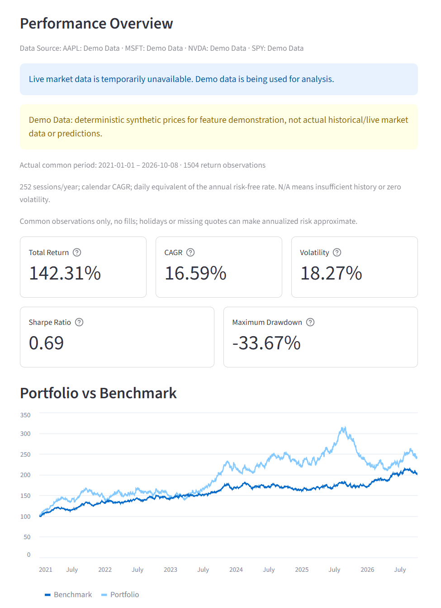
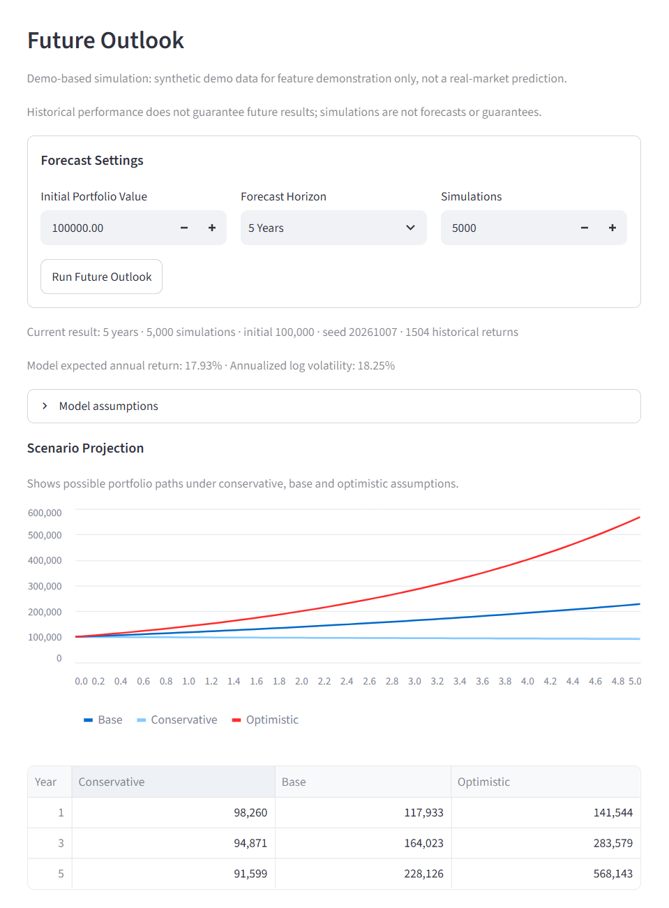
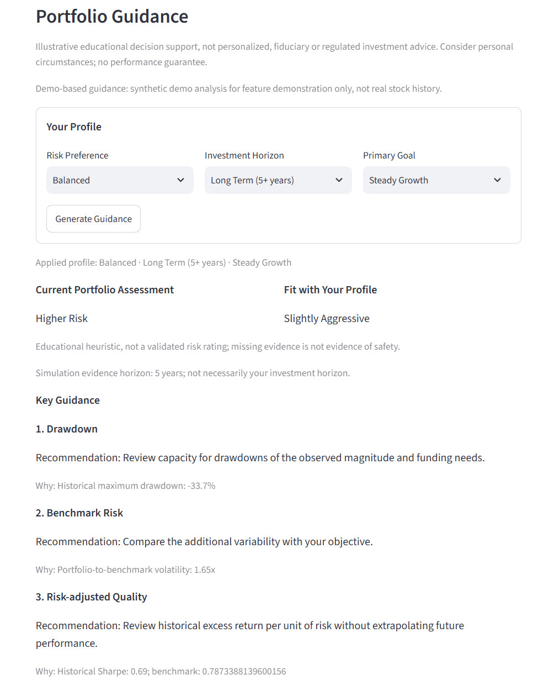
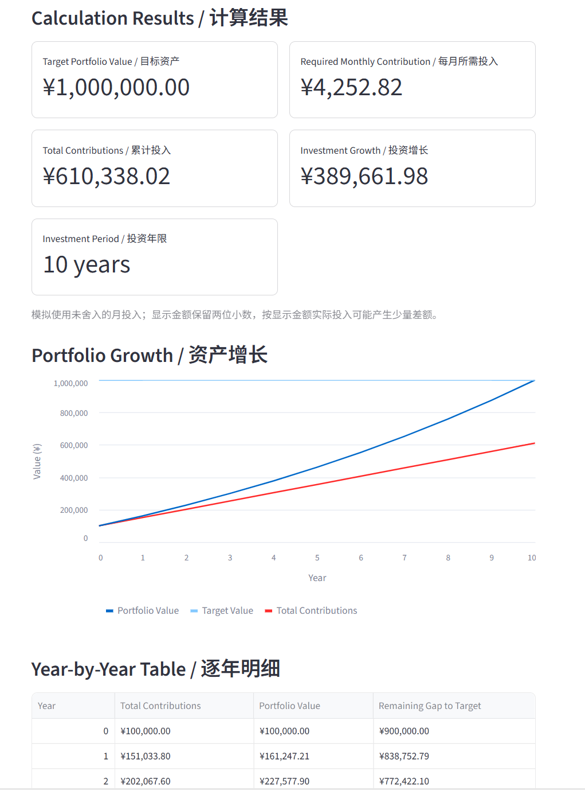

# Vexa

**Portfolio Intelligence, Made Clear.**

Vexa combines traditional portfolio analytics, probabilistic forward simulation, and the Evolance interpretation framework to turn complex financial signals into clearer decision support.

Vexa 将传统组合分析、概率模拟与 Evolance 解释框架结合，帮助理解金融信号之间的关系。

> Traditional analytics tell you what the numbers are.
>
> Evolance helps explain what they mean together.

- **[Live App / Stable Deployment](https://finance-mini-lab-knox.streamlit.app/)** — stable v0.3.0 / 稳定公开版本 v0.3.0
- **Development / 开发状态:** v0.4 — in development on `v0.4-dev`; not released or deployed / 尚未发布或部署
- **Built with:** Python · Streamlit · pandas · NumPy · SQLite · yfinance

Vexa is developed inside the **Finance Mini Lab** repository as part of **Program One**. Evolance is its signature interpretation framework. / Vexa 是产品名，Finance Mini Lab 保留为仓库与开发项目名，Evolance 是其特色解释框架。

## Why Vexa?

收益、波动率、Sharpe、回撤与模拟结果可以分别衡量组合，但用户仍需要判断：这些信号放在一起意味着什么？Vexa 在保留传统指标的同时，提供结构化解读。

Returns, volatility, Sharpe, drawdowns and simulations measure different aspects of a portfolio. Vexa adds a structured way to interpret them together, supplementing conventional analysis.

## Core Capabilities

| Area / 模块 | Capabilities / 能力 |
| --- | --- |
| **Portfolio Analytics / 历史组合分析** | Total Return, CAGR, annualized volatility, Sharpe and maximum drawdown; benchmark comparison, growth/drawdown charts and correlations / 五项核心指标、基准比较、增长与回撤曲线、相关性 |
| **Future Outlook / 未来展望** | Conservative/Base/Optimistic scenarios; GBM Monte Carlo, P10/P50/P90 and loss probability / 情景投影、概率模拟与亏损概率 |
| **Evolance / 结构化解读** | Primary State, Structural Flags, Transition, Directional Outlook and Confidence; 6M/12M outlooks when evidence permits / 状态、压力标签、变化趋势、方向与置信度 |
| **Portfolio Guidance / 组合引导** | Explainable rules using risk preference, horizon and primary goal / 结合风险偏好、期限与目标的可解释规则 |
| **Planning / 金融规划** | Compound Interest, DCA Simulator and Goal Planner, including scenarios, inflation and sensitivity / 复利、定投、目标规划及情景、通胀与敏感性分析 |

Global English/中文 selection applies across the product. / 全局语言选择支持英文与中文。

## From Traditional Analytics to Evolance

同一组证据，两种并列视角：传统分析衡量收益、风险和相对表现；Evolance 整理结构状态、压力、变化趋势、方向与置信度。

The comparison layer presents the same evidence through conventional measurements and structured interpretation. Evolance uses established financial metrics; its contribution is their organization, state transitions and decision-support presentation, rather than new financial factors.

### Evolance Framework

Five dimensions / 五个维度:

- **Growth Strength / 增长强度**
- **Downside Stability / 下行稳定性**
- **Diversification Quality / 分散化质量**
- **Return Efficiency / 收益效率**
- **Structural Resilience / 结构韧性**

These produce a primary state, independent structural flags and a transition assessment. See [Methodology](docs/METHODOLOGY.md) for evidence, thresholds and availability rules. / 维度共同形成主状态、独立标签与变化判断；证据、阈值及可用性规则见方法说明。

### Forward Outlook

```text
Current Evidence → Structural State → Transition → Probabilistic Forward Outlook
```

输出涵盖 Strong Bullish、Bullish、Neutral / Uncertain、Bearish、Strong Bearish，并附有置信度。它们是模型下的概率解读，不是确定预测或投资建议。

Directional outlooks include Strong Bullish, Bullish, Neutral / Uncertain, Bearish and Strong Bearish, with ordinal confidence. Structural state affects interpretation and confidence; it does **not** alter simulation drift or volatility. Model outputs offer possibilities, not guarantees.

## Historical Validation

冻结规则的 walk-forward 研究使用 **2005–2017 年 AAPL、MSFT、NVDA 与 SPY**。样本中，Deteriorating 与较深后续回撤相关，状态组存在描述性差异，汇总置信度组呈现描述性排序。**未确立预测优势。**

A frozen-rule walk-forward study evaluated **AAPL, MSFT, NVDA and SPY over 2005–2017**. Deteriorating transitions were associated with deeper subsequent drawdowns; state groups differed descriptively, and pooled confidence groups showed descriptive ordering. **Predictive superiority was not established.**

置信度未经独立校准，组合构成影响分组结果；有限资产范围、重叠观察期及缺少未触碰的样本外验证，限制了推广。历史关联不保证未来结果。

Confidence is not independently calibrated. Portfolio composition, a limited universe, overlapping observations and the absence of an untouched empirical holdout limit inference. Research discipline includes a frozen specification, no outcome-driven tuning, deterministic artifacts, look-ahead protection and retained failure cases.

Read the [historical validation report](docs/evolance_v1_1_real_validation.md) and [methodology](docs/METHODOLOGY.md) for findings and limitations.

## Product Architecture

```text
Streamlit inputs / global language
    → Market data / synthetic Demo Data ↔ SQLite cache & persistence
    → Traditional portfolio analytics
    → Future simulation
    → Evolance interpretation
    → Portfolio guidance

Separate research layer: frozen specification → walk-forward validation → audits
```

计算、数据、解释与界面分离。SQLite 实际存储行情缓存、组合配置及分析记录；研究脚本与私有数据入口独立于产品运行流程。

Modular calculation, data and presentation layers keep formulas out of the UI. SQLite stores prices, portfolio configurations and analysis provenance. Offline research remains separate from product runtime.

## Technology Stack

**Python · Streamlit · pandas · NumPy · SQLite (`sqlite3`) · yfinance · Monte Carlo / GBM · pytest · Git / GitHub · Streamlit Community Cloud**

Runtime and test dependencies: [requirements.txt](requirements.txt), [requirements-dev.txt](requirements-dev.txt).

## Data Strategy & Demo Mode

**SQLite Cache → Yahoo Finance → deterministic synthetic Demo Data**

Yahoo 提供实时请求的历史复权价格。若任一资产需要演示兜底，整组资产与基准统一使用 Demo Data，避免混合真实与合成行情。页面显示数据来源及非阻断式提示。

Yahoo is the primary live retrieval source for adjusted historical prices. If any asset requires fallback, the **whole portfolio and benchmark** use clearly labeled Demo Data. Source status and a non-blocking notice disclose the switch.

Demo Data 固定种子、可重复、无需 API；它不是历史行情、实时行情或当前预测，也不写入真实行情缓存。Kibot 不在公开运行路径。

Demo Data is deterministic synthetic data, not historical or live market data and not a current prediction. It is not stored in the real-price cache. Kibot is excluded from public runtime. Real historical research uses separate local/private inputs; raw price histories are excluded from Git.

## Screenshots

以下为保留的 **v0.3 历史截图**，尚未展示 v0.4 Vexa 的最终视觉与 Evolance 界面；下一阶段统一替换。

These are retained **v0.3 screenshots**, not the final v0.4 Vexa interface. Replacement is reserved for a later milestone.

### Portfolio Analytics

Historical performance, benchmark comparison, risk metrics and diversification analysis.



### Future Outlook

Scenario projections and Monte Carlo outcome distributions.



### Portfolio Guidance

Rule-based profile fit using historical and simulated risk evidence.



### Goal Planner

Goal-based planning with required monthly contribution and growth projection.



## Run Locally

Windows PowerShell，Python 虚拟环境 / Windows PowerShell with a Python virtual environment:

```powershell
git clone https://github.com/knoxlab01/Finance-Mini-Lab.git
cd Finance-Mini-Lab
python -m venv .venv
.\.venv\Scripts\python.exe -m pip install -r requirements.txt
.\.venv\Scripts\python.exe -m streamlit run streamlit_app.py
```

新克隆默认是稳定 main。本地已有 `v0.4-dev` 的工作区可直接运行后两条命令；远程已有该分支时，新克隆才可通过 `git switch v0.4-dev` 查看开发版本。无需个人行情 API key。

A fresh clone defaults to stable `main`. An existing `v0.4-dev` checkout can use the last two commands directly; a fresh clone can use `git switch v0.4-dev` only when that branch is available remotely. No personal market-data API key is required.

## Testing

**300+ automated tests** cover financial calculations, SQLite, mocked provider failures, deterministic simulation, Evolance research integrity and bilingual product behavior. / 300 余项自动化测试覆盖计算、数据库、行情兜底、模拟、研究完整性及双语产品行为。

```powershell
.\.venv\Scripts\python.exe -m pip install -r requirements-dev.txt
.\.venv\Scripts\python.exe -m pytest -q
```

The suite runs offline; live-provider success is not a test requirement. / 测试可离线运行，不要求真实行情请求成功。

## Project Evolution

| Stage | Focus / 重点 | Status / 状态 |
| --- | --- | --- |
| v0.1 | Financial planning basics / 金融规划基础 | Historical milestone / 历史阶段 |
| v0.2 | Scenarios, inflation and sensitivity / 情景、通胀、敏感性 | Historical release / 历史版本 |
| v0.3 | Portfolio analytics, Monte Carlo and guidance / 组合分析、模拟、引导 | **Stable public v0.3.0 / 当前稳定公开版本** |
| v0.4 | Vexa identity, Evolance, historical validation, global language and product polish / 品牌、解释框架、验证、全局语言与产品打磨 | **In development / 开发中，尚未发布** |

Historical context: [project log](docs/project_log.md), [v0.3 release-preparation notes](docs/release_notes_v0.3.0.md). These are preserved milestone records, not current deployment status.

## Limitations & Disclaimer

简化 GBM 使用固定参数和独立正态对数收益；历史组合假设每日按目标权重再平衡，忽略税费及交易成本。Guidance 是教育性规则，不是完整适当性评估；线上行情可用性与云端本地存储持久性均有限。

GBM assumes constant parameters and independent normal log returns. Historical portfolios rebalance daily without taxes or trading costs. Guidance is an educational rule set, not a suitability assessment. Provider availability and cloud-local storage durability are limited.

**For educational and research purposes only. Not investment advice. Historical performance and model outputs do not guarantee future results.** / **仅供教育与研究，不构成投资建议。历史表现与模型输出不保证未来结果。**

## Methodology

[Read the methodology / 阅读方法说明](docs/METHODOLOGY.md) for formulas, portfolio construction, simulation assumptions, frozen Evolance rules, provenance, validation and failure audits. It distinguishes designed and heuristic rules, observed associations, validated engineering behavior and unvalidated claims.
